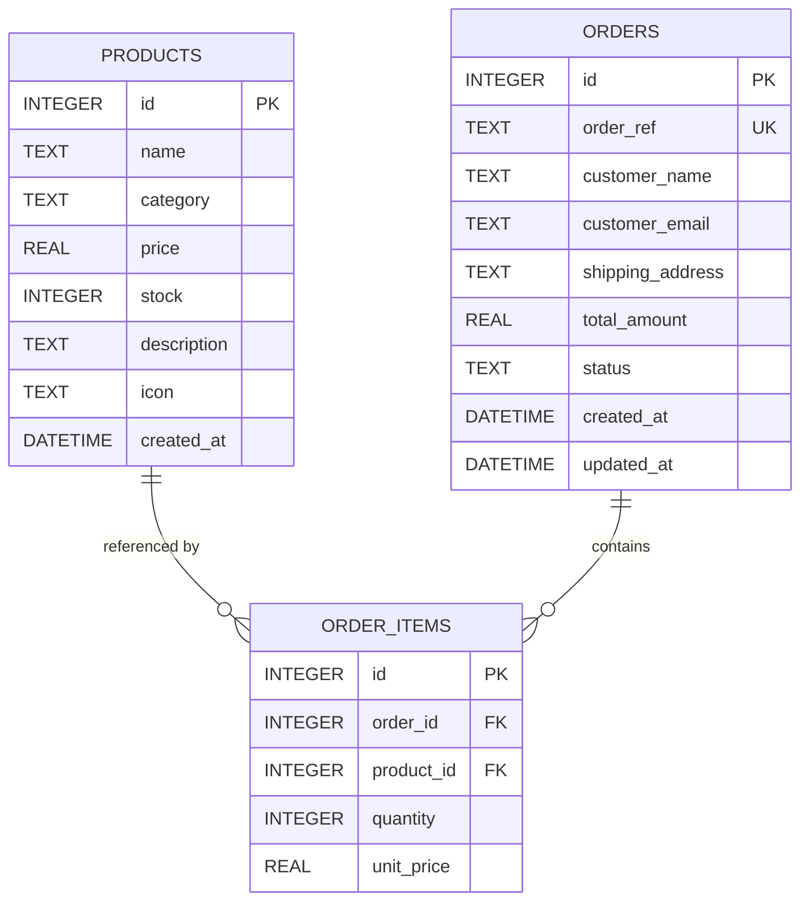
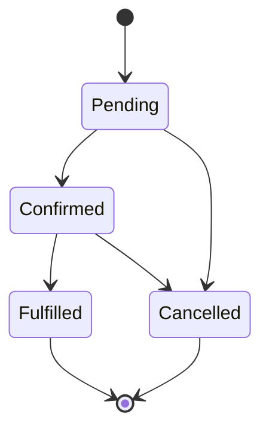

# OrderFlow — System Architecture & Data Model

## 1. System overview

OrderFlow is a three-tier, single-process application:

```text
┌─────────────────────────────┐
│ Browser                     │
│ HTML + CSS + vanilla JS SPA │
└──────────────┬──────────────┘
               │ JSON over HTTP
┌──────────────▼──────────────┐
│ Express 5 API               │
│ routes → validation → DB    │
└──────────────┬──────────────┘
               │ node:sqlite (WAL)
┌──────────────▼──────────────┐
│ SQLite                      │
│ products / orders / items   │
└─────────────────────────────┘
```

The server is the only trusted actor. The browser may request quantities, but it never decides prices, totals, stock availability or allowed status transitions.

### Customer flow

1. Catalog loads from `GET /api/products` with live stock.
2. Product dialog shows description, unit price and availability.
3. Cart state is kept in memory and persisted to `localStorage` (quantity clamped to current stock).
4. Checkout sends only `product_id` and `quantity` per line.
5. The server re-validates the payload, recomputes totals from canonical prices, checks stock and persists the order atomically.

### Admin flow

1. Admin console loads KPIs from `GET /api/stats`.
2. Order history loads from `GET /api/orders?limit=200`, rendered client-side with search and status filtering.
3. Lifecycle actions call `PATCH /api/orders/:id/status`.
4. Cancellation restores reserved stock inside the same transaction as the status change.

---

## 2. Relational schema



### `products`

| Column | Type | Constraints | Description |
| :--- | :--- | :--- | :--- |
| `id` | INTEGER | PK, AUTOINCREMENT | Product identifier |
| `name` | TEXT | NOT NULL | Display name |
| `category` | TEXT | NOT NULL | Catalog category |
| `price` | REAL | NOT NULL, `>= 0` | Canonical unit price (USD) |
| `stock` | INTEGER | NOT NULL DEFAULT 0, `>= 0` | Available inventory |
| `description` | TEXT | NOT NULL | Specification summary |
| `icon` | TEXT | NOT NULL DEFAULT `📦` | Visual identifier |
| `created_at` | DATETIME | NOT NULL DEFAULT now | Row creation time |

### `orders`

| Column | Type | Constraints | Description |
| :--- | :--- | :--- | :--- |
| `id` | INTEGER | PK, AUTOINCREMENT | Internal order id |
| `order_ref` | TEXT | UNIQUE, NOT NULL | Customer-facing reference (`ORD-######`) |
| `customer_name` | TEXT | NOT NULL | Recipient name |
| `customer_email` | TEXT | NOT NULL | Contact email |
| `shipping_address` | TEXT | NOT NULL | Delivery address |
| `total_amount` | REAL | NOT NULL, `>= 0` | Server-computed total |
| `status` | TEXT | NOT NULL, CHECK in four statuses | Lifecycle state |
| `created_at` | DATETIME | NOT NULL DEFAULT now | Order timestamp |
| `updated_at` | DATETIME | NOT NULL DEFAULT now | Last status change |

### `order_items`

| Column | Type | Constraints | Description |
| :--- | :--- | :--- | :--- |
| `id` | INTEGER | PK, AUTOINCREMENT | Line identifier |
| `order_id` | INTEGER | NOT NULL, FK → `orders(id)` ON DELETE CASCADE | Parent order |
| `product_id` | INTEGER | NOT NULL, FK → `products(id)` | Ordered product |
| `quantity` | INTEGER | NOT NULL, `> 0` | Units reserved |
| `unit_price` | REAL | NOT NULL, `>= 0` | Price snapshot at purchase time |

Prices are snapshotted on the line item so historical orders remain correct if the catalog price changes later.

### Indexes

| Index | Purpose |
| :--- | :--- |
| `idx_orders_status` | Status filtering and dashboard counts |
| `idx_orders_created_at` | Newest-first order history |
| `idx_order_items_order_id` | Efficient line-item joins |

---

## 3. Migrations & seeding

`src/db.js` runs idempotently at startup:

1. Opens `DB_PATH` (creating the parent directory if needed).
2. Enables WAL journaling, foreign keys and a 5-second busy timeout.
3. Creates tables and indexes with `IF NOT EXISTS`.
4. Adds columns introduced after the initial release (`products.created_at`, `orders.updated_at`) using `ALTER TABLE` when missing, then backfills them.
5. Seeds six demo products only when the product table is empty.

The database file is generated at runtime and is git-ignored, so a fresh clone always starts from a consistent state.

---

## 4. Order creation invariant

`POST /api/orders` executes inside `BEGIN IMMEDIATE … COMMIT`:

1. Validate and normalize the payload; aggregate duplicate product ids.
2. Read each product's price and stock from SQLite.
3. Reject unknown products (`404`) and insufficient stock (`409`).
4. Compute `total_amount` from canonical prices (rounded to cents).
5. Generate a unique `ORD-######` reference (retry on collision).
6. Insert the order and its line items.
7. Decrement stock with a guarded update (`stock >= quantity`) and verify one row changed.
8. Commit only if every step succeeds; otherwise roll back.

Consequences:

- A failed line item cannot leave a partial order or permanently reserved stock.
- Client-provided prices/totals are never read.
- Concurrent writes are serialized by the immediate transaction.

## 5. Order lifecycle invariant



- Transitions are declared once in `src/constants.js` and enforced server-side.
- `PATCH` reads the current status inside a transaction and rejects illegal transitions with `409`.
- Moving to `Cancelled` adds each line-item quantity back to `products.stock` **and** changes status in the same transaction.
- `Fulfilled` and `Cancelled` are terminal; no further transition is possible, which prevents double refunds/restocks.
- `updated_at` is refreshed on every accepted transition.

---

## 6. API layering

| Layer | Files | Responsibility |
| :--- | :--- | :--- |
| Entry point | `server.js` | Listen, browser launch, graceful shutdown |
| App assembly | `src/app.js` | Middleware order, route mounting, health, SPA fallback |
| Middleware | `src/middleware/*` | Security headers, logging, rate limiting, error mapping |
| Routing | `src/routes/*` | Endpoint contracts and SQL using prepared statements |
| Validation | `src/utils/validation.js` | Payload/query normalization and structured errors |
| Persistence | `src/db.js` | Schema, migrations, seed, transactions |
| Configuration | `src/config.js` | Environment defaults and `.env` loading |

Middleware order matters and is deliberate:

```text
security headers → request log → rate limit → JSON parser
→ health → API routes → API 404 → static files
→ SPA fallback → general 404 → central error handler
```

The central error handler converts known `HttpError`s into client-safe JSON, maps malformed JSON/oversized bodies to `400`/`413`, and hides internal details behind a generic `500`.
